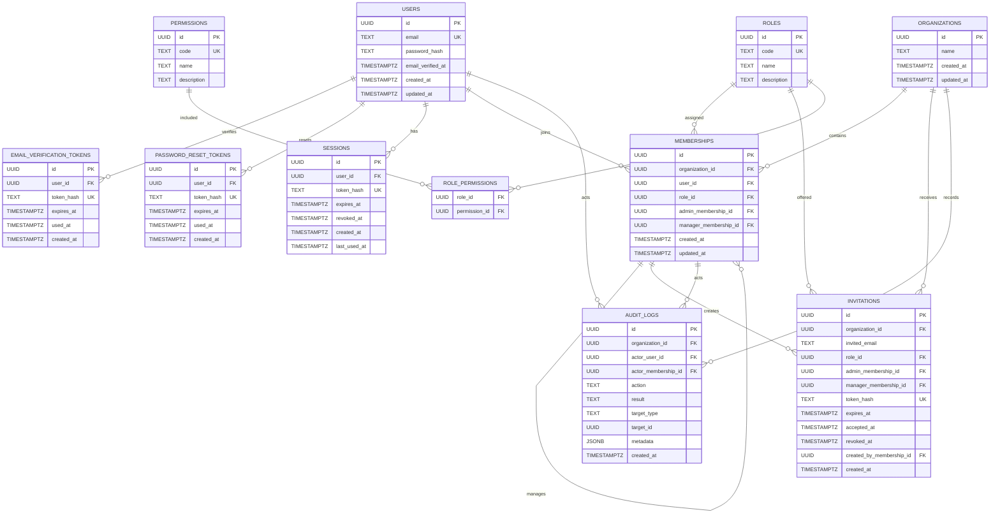

# 03. Database Design

## 1. Purpose

This document defines the relational database design for the Team Access
Control API.

The design is derived from the product and authorization specification
and is intended to be the source of truth for the PostgreSQL schema
before Prisma models and migrations are implemented.

The database must preserve:

- global users with organization-specific memberships;
- fixed organization roles and permissions;
- administrative scope and reporting relationships;
- multi-tenant isolation;
- secure sessions and authentication tokens;
- invitation lifecycle and acceptance rules;
- immutable organization-scoped audit records;
- the single-Super-User invariant.

The database design does not replace service-layer authorization.
Permission and resource-scope decisions remain application-level
authorization concerns.

---

## 2. Database

**Database:** PostgreSQL

PostgreSQL is used because the system requires:

- foreign keys;
- composite relationships;
- unique constraints;
- transactions;
- row-level locking where needed;
- JSONB audit metadata;
- indexed tenant-scoped queries;
- transactional ownership and membership changes.

All timestamps representing points in time use `TIMESTAMPTZ`.

Primary keys use UUIDs.

---

## 3. Design Principles

### 3.1 User identity is global

A user is an application-level identity and is not tied to one
organization.

The same user may have multiple memberships:

```text
User
 ├── Organization A → Admin
 ├── Organization B → Manager
 └── Organization C → Member
```

Therefore, organization role and reporting relationships belong to
`memberships`, not `users`.

### 3.2 Organization isolation

Every organization-scoped resource must be associated with an
organization.

A resource identifier alone must never be treated as proof of
authorization.

The service layer must verify:

1. authenticated user;
2. active membership in the target organization;
3. required permission;
4. target organization;
5. administrative/resource scope;
6. hierarchy and reporting rules.

### 3.3 Roles are fixed system data

The initial release has exactly four roles:

- `super_user`
- `admin`
- `manager`
- `member`

Custom roles are outside the initial release.

### 3.4 Permissions are fixed system data

Permissions are global reference data and are assigned to roles through
`role_permissions`.

A permission does not by itself grant organization-wide authority. Scope
must also be evaluated.

### 3.5 Tokens are never stored in plaintext

Raw authentication tokens are generated for the user but only their
secure hashes are persisted.

This applies to:

- sessions;
- email verification tokens;
- password reset tokens;
- invitation tokens.

### 3.6 Audit records are append-only

Audit records are never edited or deleted by product roles.

Sensitive authentication secrets must never appear in audit metadata.

---

## 4. Tables

The initial release contains eleven tables:

1. `users`
2. `email_verification_tokens`
3. `password_reset_tokens`
4. `sessions`
5. `organizations`
6. `roles`
7. `permissions`
8. `role_permissions`
9. `memberships`
10. `invitations`
11. `audit_logs`

---

## 5. `users`

### Purpose

Stores the global application identity.

A user has no organization role directly. Roles are determined through
organization memberships.

### Columns

| Column              | Type        | Null | Constraints | Purpose                                        |
| ------------------- | ----------- | ---- | ----------- | ---------------------------------------------- |
| `id`                | UUID        | No   | PK          | Global user identifier                         |
| `email`             | TEXT        | No   | UNIQUE      | Normalized email address                       |
| `password_hash`     | TEXT        | No   | —           | Argon2id password hash                         |
| `email_verified_at` | TIMESTAMPTZ | Yes  | —           | Time at which email verification was completed |
| `created_at`        | TIMESTAMPTZ | No   | —           | Account creation time                          |
| `updated_at`        | TIMESTAMPTZ | No   | —           | Last account update time                       |

### Constraints

- `id` is the primary key.
- `email` is unique.
- `email` is stored in normalized form.
- `password_hash` never contains a plaintext password.
- `email_verified_at IS NULL` means the email has not yet been
  verified.

### Email normalization

The application must validate and normalize email addresses consistently
across:

- registration;
- login;
- email verification;
- invitations;
- invitation acceptance;
- password recovery.

The database stores the normalized representation and enforces
uniqueness on it.

---

## 6. `email_verification_tokens`

### Purpose

Stores single-use email verification tokens.

### Columns

| Column       | Type        | Null | Constraints     | Purpose                            |
| ------------ | ----------- | ---- | --------------- | ---------------------------------- |
| `id`         | UUID        | No   | PK              | Token record identifier            |
| `user_id`    | UUID        | No   | FK → `users.id` | Account being verified             |
| `token_hash` | TEXT        | No   | UNIQUE          | Hash of the raw verification token |
| `created_at` | TIMESTAMPTZ | No   | —               | Creation time                      |
| `expires_at` | TIMESTAMPTZ | No   | —               | Token expiration time              |
| `used_at`    | TIMESTAMPTZ | Yes  | —               | Time token was consumed            |

### Rules

- Raw verification tokens are not persisted.
- Tokens are single-use.
- An expired token cannot verify an account.
- A used token cannot be used again.
- Verification updates `users.email_verified_at`.
- Token consumption and account verification should occur
  transactionally.

### Foreign key behavior

```text
users 1 ─── N email_verification_tokens
```

Deleting a user may cascade to their unused authentication artifacts
because those artifacts have no independent business meaning.

---

## 7. `password_reset_tokens`

### Purpose

Stores single-use password-reset tokens.

### Columns

| Column       | Type        | Null | Constraints     | Purpose                               |
| ------------ | ----------- | ---- | --------------- | ------------------------------------- |
| `id`         | UUID        | No   | PK              | Token record identifier               |
| `user_id`    | UUID        | No   | FK → `users.id` | Account whose password is being reset |
| `token_hash` | TEXT        | No   | UNIQUE          | Hash of the raw reset token           |
| `expires_at` | TIMESTAMPTZ | No   | —               | Token expiration time                 |
| `used_at`    | TIMESTAMPTZ | Yes  | —               | Time token was consumed               |
| `created_at` | TIMESTAMPTZ | No   | —               | Creation time                         |

### Rules

- Raw reset tokens are never persisted.
- Tokens are single-use.
- Expired tokens are invalid.
- Used tokens are invalid.
- Successful password reset must revoke all active sessions for the
  user.
- Password reset and session revocation should be performed
  transactionally.

---

## 8. `sessions`

### Purpose

Stores server-managed authenticated sessions.

The application uses opaque, cryptographically secure session
identifiers in Secure, HttpOnly cookies.

### Columns

| Column         | Type        | Null | Constraints     | Purpose                   |
| -------------- | ----------- | ---- | --------------- | ------------------------- |
| `id`           | UUID        | No   | PK              | Session record identifier |
| `user_id`      | UUID        | No   | FK → `users.id` | Authenticated user        |
| `token_hash`   | TEXT        | No   | UNIQUE          | Hash of the session token |
| `expires_at`   | TIMESTAMPTZ | No   | —               | Session expiration        |
| `revoked_at`   | TIMESTAMPTZ | Yes  | —               | Time session was revoked  |
| `created_at`   | TIMESTAMPTZ | No   | —               | Session creation time     |
| `last_used_at` | TIMESTAMPTZ | Yes  | —               | Last successful use       |

### Session validity

A session is valid only when:

```text
revoked_at IS NULL
AND
expires_at > current time
```

The service layer must additionally authenticate the user and evaluate
organization authorization separately.

### Rules

- A user may have multiple concurrent sessions.
- A user may revoke one session.
- A user may revoke all sessions.
- Logout revokes the relevant session.
- Password change revokes all sessions.
- Password reset revokes all sessions.
- Raw session tokens are never persisted.
- Session tokens must be cryptographically random.

### Relationship

```text
users 1 ─── N sessions
```

Sessions are user-scoped, not organization-scoped.

---

## 9. `organizations`

### Purpose

Stores tenants/workspaces.

### Columns

| Column       | Type        | Null | Constraints | Purpose                 |
| ------------ | ----------- | ---- | ----------- | ----------------------- |
| `id`         | UUID        | No   | PK          | Organization identifier |
| `name`       | TEXT        | No   | —           | Organization name       |
| `created_at` | TIMESTAMPTZ | No   | —           | Creation time           |
| `updated_at` | TIMESTAMPTZ | No   | —           | Last update time        |

### Ownership model

There is intentionally **no `owner_id` column**.

Ownership is represented by the organization's membership with role
`super_user`.

Therefore:

```text
organization
    │
    └── membership
            ├── user
            └── role = super_user
```

This avoids maintaining two independent ownership sources of truth.

### Organization creation

A verified, authenticated user may create an organization.

The organization creation transaction must create:

1. the organization;
2. the creator's membership;
3. the `super_user` role assignment;
4. the corresponding audit record.

The transaction must not expose an organization without its initial
Super User.

---

## 10. `roles`

### Purpose

Stores fixed system roles.

Roles are global reference data and are not organization-specific.

### Columns

| Column        | Type | Null | Constraints | Purpose                           |
| ------------- | ---- | ---- | ----------- | --------------------------------- |
| `id`          | UUID | No   | PK          | Role identifier                   |
| `code`        | TEXT | No   | UNIQUE      | Stable machine-readable role code |
| `name`        | TEXT | No   | —           | Human-readable role name          |
| `description` | TEXT | No   | —           | Role description                  |

### Initial roles

| Code         | Name       | Meaning                                                                                          |
| ------------ | ---------- | ------------------------------------------------------------------------------------------------ |
| `super_user` | Super User | Organization-wide administrative authority and Owner                                             |
| `admin`      | Admin      | Manages Managers assigned to the Admin and Members under those Managers, plus unassigned Members |
| `manager`    | Manager    | Manages Members directly assigned to the Manager                                                 |
| `member`     | Member     | Organization participant without membership-management authority                                 |

### Rules

These four roles are system-defined and immutable during normal
application operation.

Custom roles are deferred.

---

## 11. `permissions`

### Purpose

Stores fixed system permissions.

### Columns

| Column        | Type | Null | Constraints | Purpose                                 |
| ------------- | ---- | ---- | ----------- | --------------------------------------- |
| `id`          | UUID | No   | PK          | Permission identifier                   |
| `code`        | TEXT | No   | UNIQUE      | Stable machine-readable permission code |
| `name`        | TEXT | No   | —           | Human-readable permission name          |
| `description` | TEXT | No   | —           | Permission meaning                      |

### Initial permissions

| Code                  | Meaning                                                                                     |
| --------------------- | ------------------------------------------------------------------------------------------- |
| `organization.read`   | View basic organization information                                                         |
| `membership.read`     | View organization members, roles, and reporting relationships permitted by visibility rules |
| `invitation.create`   | Create an invitation for an allowed role and reporting assignment                           |
| `invitation.revoke`   | Revoke an invitation within permitted scope                                                 |
| `membership.update`   | Change a membership role or valid reporting assignment within permitted scope               |
| `membership.remove`   | Remove a membership within permitted scope                                                  |
| `organization.manage` | Update organization settings and transfer ownership                                         |
| `audit_log.read`      | View organization audit events when authorized                                              |
| `session.manage_self` | View and revoke the actor's own sessions                                                    |
| `session.manage_any`  | Revoke another user's sessions when that user is within the actor's permitted scope         |

Permissions are global reference data.

---

## 12. `role_permissions`

### Purpose

Many-to-many mapping between fixed roles and permissions.

### Columns

| Column          | Type | Null | Constraints           | Purpose    |
| --------------- | ---- | ---- | --------------------- | ---------- |
| `role_id`       | UUID | No   | FK → `roles.id`       | Role       |
| `permission_id` | UUID | No   | FK → `permissions.id` | Permission |

### Primary key

```text
PRIMARY KEY (role_id, permission_id)
```

This prevents duplicate role-permission mappings.

### Initial mapping

The mapping below reflects the organization-role authorization matrix in
the product specification.

| Permission            | Super User | Admin | Manager | Member |
| --------------------- | ---------- | ----- | ------- | ------ |
| `organization.read`   | Yes        | Yes   | Yes     | Yes    |
| `membership.read`     | Yes        | Yes   | Yes     | Yes    |
| `invitation.create`   | Yes        | Yes   | Yes     | No     |
| `invitation.revoke`   | Yes        | Yes   | Yes     | No     |
| `membership.update`   | Yes        | Yes   | No      | No     |
| `membership.remove`   | Yes        | Yes   | Yes     | No     |
| `organization.manage` | Yes        | No    | No      | No     |
| `audit_log.read`      | Yes        | Yes   | No      | No     |
| `session.manage_self` | Yes        | Yes   | Yes     | Yes    |
| `session.manage_any`  | Yes        | Yes   | Yes     | No     |

**Important:** the permission mapping is not sufficient to authorize an
operation. The service layer must also enforce the role-specific scope
and hierarchy rules from the product specification.

---

## 13. `memberships`

### Purpose

Represents a user's relationship with one organization.

This is the central authorization entity.

A membership determines:

- organization;
- user;
- role;
- Admin reporting relationship for Managers;
- Manager reporting relationship for Members.

### Columns

| Column                  | Type        | Null | Constraints             | Purpose                          |
| ----------------------- | ----------- | ---- | ----------------------- | -------------------------------- |
| `id`                    | UUID        | No   | PK                      | Membership identifier            |
| `organization_id`       | UUID        | No   | FK → `organizations.id` | Organization                     |
| `user_id`               | UUID        | No   | FK → `users.id`         | Global user                      |
| `role_id`               | UUID        | No   | FK → `roles.id`         | Organization-specific role       |
| `admin_membership_id`   | UUID        | Yes  | Self-FK                 | Admin responsible for a Manager  |
| `manager_membership_id` | UUID        | Yes  | Self-FK                 | Manager responsible for a Member |
| `created_at`            | TIMESTAMPTZ | No   | —                       | Membership creation time         |
| `updated_at`            | TIMESTAMPTZ | No   | —                       | Last membership update           |

### Membership uniqueness

A user may have at most one membership in an organization:

```text
UNIQUE (user_id, organization_id)
```

This prevents duplicate organization memberships.

### Reporting relationships

#### Manager

A Manager may have:

```text
admin_membership_id = NULL
```

or:

```text
admin_membership_id = another membership with role = admin
```

A Manager can therefore be:

- assigned to exactly one Admin; or
- unassigned.

#### Member

A Member may have:

```text
manager_membership_id = NULL
```

or:

```text
manager_membership_id = another membership with role = manager
```

A Member can therefore be:

- assigned to exactly one Manager; or
- unassigned.

#### Admin and Super User

Admin and Super User memberships must have:

```text
admin_membership_id = NULL
manager_membership_id = NULL
```

### Organization-aware reporting references

Reporting relationships must not be able to point to a membership
belonging to another organization.

Conceptually:

```text
(admin_membership_id, organization_id)
    → memberships(id, organization_id)

(manager_membership_id, organization_id)
    → memberships(id, organization_id)
```

This creates a database-level tenant boundary for reporting
relationships.

The service layer must additionally verify that the referenced
membership has the correct role.

### Role/reporting compatibility

The following states are valid:

| Role       | `admin_membership_id`      | `manager_membership_id`      |
| ---------- | -------------------------- | ---------------------------- |
| Super User | `NULL`                     | `NULL`                       |
| Admin      | `NULL`                     | `NULL`                       |
| Manager    | Admin membership or `NULL` | `NULL`                       |
| Member     | `NULL`                     | Manager membership or `NULL` |

Role/reporting compatibility must be enforced atomically by the service
layer.

### Role-change rules

#### Member → Manager

When a Member becomes a Manager:

```text
manager_membership_id → NULL
admin_membership_id → valid Admin or NULL
```

The former Manager assignment is no longer valid.

#### Manager → Admin

When a Manager becomes an Admin:

```text
admin_membership_id → NULL
manager_membership_id → NULL
```

The former Admin assignment is no longer valid.

#### Other role changes

All role changes must clear reporting relationships that are
incompatible with the new role.

### Removal behavior

Removing an Admin:

- Managers assigned to that Admin remain organization members;
- their `admin_membership_id` becomes NULL;
- Members assigned to those Managers remain assigned to those
  Managers.

Removing a Manager:

- Members assigned directly to that Manager remain organization
  members;
- their `manager_membership_id` becomes NULL.

Subordinate memberships must not be cascaded away.

### Scope

The database stores relationships. It does not attempt to encode the
complete administrative scope as a denormalized field.

Scope is derived from current membership relationships.

---

## 14. `invitations`

### Purpose

Stores invitations to join an organization.

An invitation is associated with an email address rather than
necessarily an existing user because the recipient may not yet have an
account.

### Columns

| Column                     | Type        | Null | Constraints             | Purpose                                           |
| -------------------------- | ----------- | ---- | ----------------------- | ------------------------------------------------- |
| `id`                       | UUID        | No   | PK                      | Invitation identifier                             |
| `organization_id`          | UUID        | No   | FK → `organizations.id` | Target organization                               |
| `invited_email`            | TEXT        | No   | —                       | Normalized recipient email                        |
| `role_id`                  | UUID        | No   | FK → `roles.id`         | Offered role                                      |
| `admin_membership_id`      | UUID        | Yes  | Self/reference          | Offered Admin assignment for Manager invitations  |
| `manager_membership_id`    | UUID        | Yes  | Self/reference          | Offered Manager assignment for Member invitations |
| `token_hash`               | TEXT        | No   | UNIQUE                  | Hash of opaque invitation token                   |
| `expires_at`               | TIMESTAMPTZ | No   | —                       | Invitation expiration                             |
| `accepted_at`              | TIMESTAMPTZ | Yes  | —                       | Acceptance time                                   |
| `revoked_at`               | TIMESTAMPTZ | Yes  | —                       | Revocation time                                   |
| `created_by_membership_id` | UUID        | Yes  | FK → `memberships.id`   | Membership that created the invitation            |
| `created_at`               | TIMESTAMPTZ | No   | —                       | Creation time                                     |

### Invitation state

No separate `status` column is required.

State is derived from timestamps:

#### Pending

```text
accepted_at IS NULL
AND
revoked_at IS NULL
AND
expires_at > current time
```

#### Accepted

```text
accepted_at IS NOT NULL
```

#### Revoked

```text
revoked_at IS NOT NULL
```

#### Expired

```text
accepted_at IS NULL
AND
revoked_at IS NULL
AND
expires_at <= current time
```

### Token security

- The raw invitation token is never stored.
- `token_hash` is unique.
- The raw token must be cryptographically random and opaque.
- The token is single-use.
- The invitation expires after seven calendar days.

### Invitation role rules

#### Super User

May invite:

- Admin;
- Manager;
- Member.

The Super User may assign:

- Manager → any Admin or unassigned;
- Member → any eligible Manager or unassigned.

The Super User cannot invite another Super User.

#### Admin

May invite:

- Manager, automatically assigned to the inviting Admin;
- Member, assigned to a Manager within the Admin's scope or left
  unassigned.

#### Manager

May invite:

- Member, automatically assigned to the inviting Manager.

#### Member

Cannot create invitations.

### Invitation acceptance

Acceptance must be transactional.

The acceptance workflow must verify:

1. invitation token is valid;
2. invitation has not expired;
3. invitation has not been revoked;
4. invitation has not already been accepted;
5. authenticated user's verified email matches `invited_email`;
6. target organization still exists;
7. offered role is still valid;
8. offered reporting assignment is still valid;
9. the user does not already have a membership in the organization.

Then the transaction creates the membership and marks the invitation
accepted.

### Creator deletion

`created_by_membership_id` is nullable because the creator's membership
may later be removed.

Historical invitations must remain auditable.

When the creator membership is removed, the creator reference may become
NULL.

### Pending duplicate invitations

The specification requires that duplicate pending invitations do not
create ambiguous concurrent offers.

This must be handled transactionally by the service layer.

A time-dependent partial unique index based on `expires_at > NOW()`
should not be used as the mechanism.

The service may instead:

- reuse/resend the existing pending invitation; or
- require the existing invitation to be revoked before creating
  another.

---

## 15. `audit_logs`

### Purpose

Stores immutable, organization-scoped security and authorization events.

### Columns

| Column                | Type        | Null | Constraints             | Purpose                                  |
| --------------------- | ----------- | ---- | ----------------------- | ---------------------------------------- |
| `id`                  | UUID        | No   | PK                      | Audit record identifier                  |
| `organization_id`     | UUID        | No   | FK → `organizations.id` | Organization where the event occurred    |
| `actor_user_id`       | UUID        | Yes  | FK → `users.id`         | User responsible for the event           |
| `actor_membership_id` | UUID        | Yes  | FK → `memberships.id`   | Membership through which the actor acted |
| `action`              | TEXT        | No   | —                       | Stable event/action identifier           |
| `result`              | TEXT        | No   | CHECK                   | `success` or `denied`                    |
| `target_type`         | TEXT        | Yes  | —                       | Type of target resource                  |
| `target_id`           | UUID        | Yes  | —                       | Target resource identifier               |
| `metadata`            | JSONB       | No   | DEFAULT `{}`            | Safe additional event data               |
| `created_at`          | TIMESTAMPTZ | No   | —                       | Event time                               |

### Result constraint

```text
result IN ('success', 'denied')
```

### Target representation

The target is intentionally polymorphic:

```text
target_type
target_id
```

because audit events may target:

- organization;
- user;
- membership;
- invitation;
- session;
- other organization-scoped resources.

`target_id` is therefore not a conventional foreign key.

### Actor references

`actor_user_id` and `actor_membership_id` are nullable to support events
where:

- there is no authenticated actor;
- an event is generated by a system/background process;
- the actor membership no longer exists.

Audit history must not disappear merely because a membership is later
removed.

### Metadata restrictions

Audit metadata must never contain:

- passwords;
- raw session tokens;
- raw invitation tokens;
- password-reset tokens;
- email-verification tokens;
- TOTP secrets;
- recovery codes;
- other authentication secrets.

### Required event categories

The audit design must support events such as:

- organization created;
- organization updated;
- ownership transferred;
- invitation created;
- invitation resent;
- invitation accepted;
- invitation revoked;
- invitation expiration observed;
- membership created;
- membership role changed;
- Manager/Admin assignment changed;
- Member/Manager assignment changed;
- membership removed;
- session created;
- session revoked;
- all sessions revoked;
- password changed;
- password reset;
- logout;
- sensitive authorization denial.

Account-level authentication events that do not belong to an
organization may be stored separately in a future security-event design.
They should not be forced into an organization-scoped audit record with
a fabricated organization.

### Append-only behavior

The application must not provide product operations that update or
delete audit records.

Audit records should be inserted only.

---

## 16. Relationships

### Primary relationships

```text
users
  │
  ├──< email_verification_tokens
  ├──< password_reset_tokens
  ├──< sessions
  └──< memberships
             │
             ├──> organizations
             ├──> roles
             ├──> memberships (Admin assignment)
             └──> memberships (Manager assignment)

roles
  │
  └──< role_permissions >── permissions

organizations
  │
  ├──< memberships
  ├──< invitations
  └──< audit_logs

invitations
  ├──> organizations
  ├──> roles
  ├──> memberships (creator)
  └──> memberships (reporting assignments)

audit_logs
  ├──> organizations
  ├──> users
  └──> memberships
```

---

## 17. ER Diagram



## 18. Indexes

The unique constraint also provides the required lookup index for
normalized email.

### `email_verification_tokens`

```text
UNIQUE (token_hash)
INDEX (user_id)
INDEX (expires_at)
```

### `password_reset_tokens`

```text
UNIQUE (token_hash)
INDEX (user_id)
INDEX (expires_at)
```

### `sessions`

```text
UNIQUE (token_hash)
INDEX (user_id)
INDEX (user_id, revoked_at)
INDEX (expires_at)
```

### `organizations`

The primary key index on `id` is sufficient for direct organization
lookup.

### `roles`

```text
UNIQUE (code)
```

### `permissions`

```text
UNIQUE (code)
```

### `role_permissions`

```text
PRIMARY KEY (role_id, permission_id)
INDEX (permission_id)
```

### `memberships`

```text
UNIQUE (user_id, organization_id)
UNIQUE (id, organization_id)
INDEX (organization_id)
INDEX (organization_id, role_id)
INDEX (organization_id, user_id)
INDEX (admin_membership_id)
INDEX (manager_membership_id)
INDEX (user_id)
```

The `(id, organization_id)` uniqueness is required if organization-aware
composite foreign keys reference the pair.

### `invitations`

```text
UNIQUE (token_hash)
INDEX (organization_id)
INDEX (organization_id, invited_email)
INDEX (created_by_membership_id)
INDEX (expires_at)
```

### `audit_logs`

```text
INDEX (organization_id, created_at)
INDEX (actor_user_id, created_at)
INDEX (actor_membership_id, created_at)
INDEX (target_type, target_id)
INDEX (action, created_at)
```

The organization/time index is especially important because audit-log
reads are organization-scoped and normally chronological.

---

## 19. Foreign Key Behavior

The exact Prisma relation configuration and generated SQL must preserve
the following business behavior.

### Authentication artifacts

Authentication artifacts have no independent business meaning.

Where user deletion is supported in the future:

- email verification tokens may cascade;
- password reset tokens may cascade;
- sessions may cascade.

Account deletion itself is not part of the initial product
specification.

### Memberships

Removing an Admin must not remove subordinate memberships.

Removing a Manager must not remove subordinate memberships.

Instead:

```text
Admin removed
    ↓
Manager.admin_membership_id = NULL
```

and:

```text
Manager removed
    ↓
Member.manager_membership_id = NULL
```

The service transaction must perform these changes explicitly.

### Audit logs

Audit history must not be cascaded away by deletion of users or
memberships.

Historical audit records are part of the security history.

### Invitation creator

When a creator membership is removed:

```text
invitations.created_by_membership_id = NULL
```

The invitation itself remains available for historical auditing and
lifecycle handling.

### Exact ON DELETE behavior

The following foreign-key behaviors must be preserved in the PostgreSQL schema:

| Foreign Key                                               | ON DELETE behavior | Reason                                                                                        |
| --------------------------------------------------------- | ------------------ | --------------------------------------------------------------------------------------------- |
| `email_verification_tokens.user_id` → `users.id`          | CASCADE            | Verification tokens have no independent meaning                                               |
| `password_reset_tokens.user_id` → `users.id`              | CASCADE            | Reset tokens have no independent meaning                                                      |
| `sessions.user_id` → `users.id`                           | CASCADE            | Sessions have no independent meaning after account deletion                                   |
| `memberships.user_id` → `users.id`                        | RESTRICT           | Memberships must not be silently deleted                                                      |
| `memberships.organization_id` → `organizations.id`        | RESTRICT           | Organization deletion is not part of the initial product                                      |
| `memberships.role_id` → `roles.id`                        | RESTRICT           | System roles are immutable reference data                                                     |
| `memberships.admin_membership_id` → `memberships.id`      | SET NULL           | Removing an Admin unassigns its Managers                                                      |
| `memberships.manager_membership_id` → `memberships.id`    | SET NULL           | Removing a Manager unassigns its Members                                                      |
| `invitations.organization_id` → `organizations.id`        | RESTRICT           | Invitations must not be silently deleted                                                      |
| `invitations.role_id` → `roles.id`                        | RESTRICT           | System roles are immutable reference data                                                     |
| `invitations.created_by_membership_id` → `memberships.id` | SET NULL           | Preserve invitation history after creator removal                                             |
| `invitations.admin_membership_id` → `memberships.id`      | RESTRICT           | A pending invitation with an Admin assignment must be handled before that Admin is removed    |
| `invitations.manager_membership_id` → `memberships.id`    | RESTRICT           | A pending invitation with a Manager assignment must be handled before that Manager is removed |
| `audit_logs.organization_id` → `organizations.id`         | RESTRICT           | Audit history must not be silently deleted                                                    |
| `audit_logs.actor_user_id` → `users.id`                   | SET NULL           | Preserve audit history                                                                        |
| `audit_logs.actor_membership_id` → `memberships.id`       | SET NULL           | Preserve audit history                                                                        |

---

## 20. Critical Database Invariants

### 20.1 One membership per user per organization

```text
UNIQUE (user_id, organization_id)
```

A user cannot have two memberships in the same organization.

### 20.2 Exactly one Super User

Every organization must have exactly one Super User.

This invariant has two parts:

#### At most one

The database design should enforce at most one `super_user` membership
per organization.

Because the role is represented by a foreign key to `roles`, the final
PostgreSQL migration should use the stable seeded identifier for the
immutable `super_user` role in a partial unique index, for example
conceptually:

```sql
UNIQUE (organization_id)
WHERE role_id = <fixed-super-user-role-id>
```

The role seed must therefore use a stable UUID.

#### At least one

The application transaction must ensure an organization never becomes
ownerless.

This is especially important during:

- organization creation;
- ownership transfer;
- Super User membership changes;
- membership removal.

Ownership transfer must never commit an intermediate state visible to
another transaction.

### 20.3 Ownership transfer

Ownership transfer is a single transaction:

```text
BEGIN

lock organization / relevant memberships

verify actor is current Super User
verify target is an eligible existing organization member

target.role = super_user
previous_owner.role = admin

write audit record

COMMIT
```

The exact ordering and locking strategy will be implemented in the
service/database layer so concurrent ownership changes cannot produce
two owners or zero owners.

The current Super User cannot be directly removed or demoted.

### 20.4 Reporting hierarchy

Valid hierarchy:

```text
Super User
     │
     ├── Admin
     │     └── Manager
     │            └── Member
     │
     └── Manager (unassigned)
            └── Member
```

A Manager has zero or one Admin.

A Member has zero or one Manager.

Cross-organization reporting assignments are forbidden.

### 20.5 Role/reporting consistency

The following combinations must never be committed:

```text
Admin + admin_membership_id
Admin + manager_membership_id

Super User + admin_membership_id
Super User + manager_membership_id

Manager + manager_membership_id

Member + admin_membership_id
```

The service layer must clear invalid reporting assignments as part of
the same transaction as role changes.

---

## 21. Transactional Operations

The following operations must be atomic.

### Organization creation

```text
create organization
+
create initial Super User membership
+
audit event
```

### Ownership transfer

```text
authorize
+
lock relevant state
+
old owner → Admin
+
target member → Super User
+
audit event
```

### Role change

```text
authorize
+
change role
+
clear/replace invalid reporting relationship
+
audit event
```

### Admin removal

```text
authorize
+
unassign Managers from Admin
+
remove Admin membership
+
audit event
```

### Manager removal

```text
authorize
+
unassign Members from Manager
+
remove Manager membership
+
handle/revoke affected pending invitations where required
+
audit event
```

### Invitation acceptance

```text
validate token
+
validate invitation state
+
validate email
+
validate role/reporting assignment
+
check duplicate membership
+
create membership
+
mark invitation accepted
+
audit event
```

### Password reset

```text
validate reset token
+
change password
+
consume reset token
+
revoke all sessions
+
audit security event
```

---

## 22. Authorization and Database Responsibilities

The database stores the trusted state required for authorization.

The service layer makes the authorization decision.

### Database responsibility

The database should enforce structural invariants such as:

- primary keys;
- foreign keys;
- uniqueness;
- organization-aware reporting references;
- valid audit result values;
- required columns;
- token hash uniqueness.

### Service-layer responsibility

The application must enforce rules such as:

- whether the actor has the required permission;
- whether the target is within the actor's scope;
- whether an Admin may manage a particular Manager;
- whether a Manager may manage a particular Member;
- whether an invitation may be created for a target role;
- whether a reporting assignment is allowed for the inviter;
- whether ownership transfer is permitted;
- whether recent authentication is required.

The database and service layer therefore provide complementary
protection.

---

## 23. Reference Data Seeding

Roles and permissions are system reference data.

They must be inserted during database initialization/seed.

### Roles

```text
super_user
admin
manager
member
```

### Permissions

```text
organization.read
membership.read
invitation.create
invitation.revoke
membership.update
membership.remove
organization.manage
audit_log.read
session.manage_self
session.manage_any
```

### Seed characteristics

Reference data should be:

- deterministic;
- idempotent;
- stable across environments;
- treated as application-owned data.

The `super_user` role must have a stable UUID because the database-level
single-Super-User uniqueness rule depends on identifying that immutable
system role.

The exact UUID values will be defined in the seed/migration
implementation.

---

## 24. Prisma Considerations

Prisma will be used as the ORM and migration tool.

The Prisma schema must represent the relational model defined here.

Some PostgreSQL-specific constraints may require generated/raw SQL in
the migration rather than relying solely on Prisma schema syntax,
particularly:

- organization-aware composite foreign-key behavior;
- the partial unique index for the Super User invariant;
- any PostgreSQL-specific constraint syntax required by the final
  migration.

The database design remains the source of truth. Prisma must not cause
the relational model to be weakened merely for ORM convenience.

---

## 25. Deferred Database Extensions

The following are intentionally outside the initial database design
unless later requirements require them:

- TOTP secrets;
- recovery-code hashes;
- API keys;
- custom roles;
- custom permissions;
- groups;
- flexible delegation;
- SSO identity-provider tables;
- SCIM provisioning;
- device-risk data;
- billing/subscription tables;
- advanced audit retention/export structures.

The product specification explicitly treats these as future
capabilities.

---

## 26. Security Rules Summary

The database implementation must preserve these rules:

1. Users are global identities.
2. Roles belong to memberships, not users.
3. Organizations are isolated tenants.
4. A user has at most one membership per organization.
5. Exactly one Super User exists per organization.
6. Ownership transfer is atomic.
7. Managers have zero or one Admin.
8. Members have zero or one Manager.
9. Reporting references cannot cross organizations.
10. Invalid reporting relationships are cleared during role changes.
11. Raw session tokens are not stored.
12. Raw invitation tokens are not stored.
13. Raw email-verification tokens are not stored.
14. Raw password-reset tokens are not stored.
15. Passwords are stored only as Argon2id hashes.
16. Audit logs are append-only.
17. Audit metadata cannot contain authentication secrets.
18. Product roles cannot edit or delete audit records.
19. Authorization requires both permission and resource scope.
20. Database integrity and application authorization must work together.

---

## 27. Final Table Summary

| Table                       | Scope            | Main responsibility                    |
| --------------------------- | ---------------- | -------------------------------------- |
| `users`                     | Global           | User identity and credentials          |
| `email_verification_tokens` | User             | Email verification                     |
| `password_reset_tokens`     | User             | Password recovery                      |
| `sessions`                  | User             | Server-managed authentication sessions |
| `organizations`             | Global tenant    | Organization identity                  |
| `roles`                     | Global reference | Fixed system roles                     |
| `permissions`               | Global reference | Fixed capabilities                     |
| `role_permissions`          | Global reference | Role-to-permission mapping             |
| `memberships`               | Organization     | User role and reporting relationships  |
| `invitations`               | Organization     | Invitation lifecycle                   |
| `audit_logs`                | Organization     | Immutable security/audit history       |

## 28. Implementation Order

After this document is approved, implementation should proceed in this
order:

```text
1. PostgreSQL schema
        ↓
2. Prisma schema
        ↓
3. Initial migration
        ↓
4. Reference-data seed
        ↓
5. Database integrity tests
        ↓
6. Data-access layer
        ↓
7. Authentication services
        ↓
8. Authorization services
        ↓
9. API specification
```

The next artifact after the database design is the PostgreSQL/Prisma
implementation, not the API design.

---

## 29. Design Status

### Status: Approved database design

This document is intended to be the stable database-design baseline for
the initial release.

Changes after this point should be driven by:

- a discovered product requirement conflict;
- a security/integrity issue;
- an implementation constraint that cannot reasonably be solved
  without changing the model;
- or an explicitly approved product change.

The Prisma schema and migrations must implement this design rather than
independently redefining the domain model.
